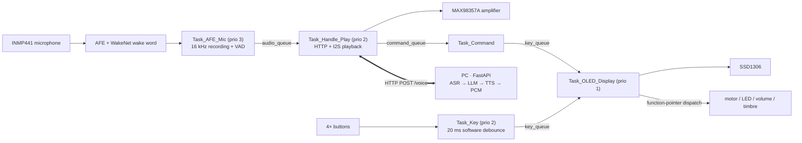
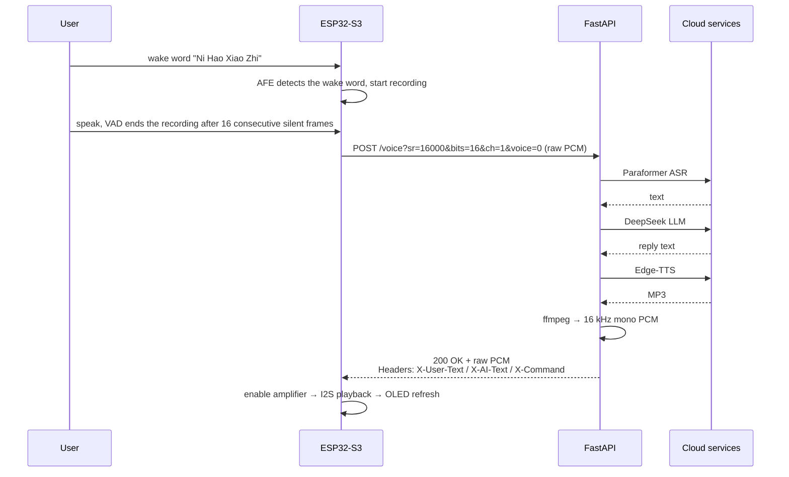

# ESP32-S3 AI Voice Assistant

**Say one sentence and the device speaks the reply.** The wake word is recognized on-device; ASR / LLM / TTS run on a PC. The synthesized speech is returned as PCM and played through an I2S amplifier. The local OLED menu keeps working when the network is down and can adjust the motor, LED, volume and timbre independently.

[](https://github.com/3209235361-wq/Esp32-chat-assistant/actions/workflows/build.yml)
[](LICENSE)


[](https://hub.xerj.org/contributors/3209235361-wq)

`C` · `ESP-IDF v5.4` · `FreeRTOS` · `esp-sr (AFE + WakeNet)` · `I2S / I2C / LEDC` · `HTTP` · `FastAPI + Python` · `DashScope ASR` · `DeepSeek LLM` · `Edge-TTS`

> An ESP32-S3 voice assistant — on-device WakeNet wake word, cloud ASR → LLM → TTS over HTTP, PCM playback through a MAX98357A, plus a local OLED menu (intrusive doubly-linked list + `container_of` dispatch) that keeps working when Wi-Fi is down.

---

## Hardware photo


ESP32-S3 MCU · INMP441 microphone · MAX98357A amplifier · SSD1306 OLED · motor · LED

## Features

- **Voice conversation**: on-device wake word (WakeNet) → recording (VAD auto segmentation) → upload → ASR → LLM → TTS → playback
- **Voice control of devices**: say commands such as "开灯" (light on) or "电机高档" (motor high); the server parses the recognized text and returns the command in the HTTP response header `X-Command`, which the device executes directly
- **Local OLED menu**: motor speed / LED brightness / volume / timbre, four items with button navigation, **works offline**
- **Voice switching**: 4 TTS voices (Mandarin female / male / Cantonese / English), switchable by voice or buttons
- **Unified error handling**: every init step has its own error counter; the device stops and logs instead of running half-initialized

## Hardware

| Component | Model | Purpose | Pin |
|---|---|---|---|
| MCU | ESP32-S3-N16R8 (16 MB Flash / 8 MB PSRAM) | Main controller | — |
| Microphone | INMP441 (I2S digital mic) | Recording | SD → GPIO2 |
| Amplifier | MAX98357A (I2S amplifier) | Playback | DIN → GPIO5, SD (enable) → GPIO4 |
| Display | SSD1306 0.96" (I2C) | Local UI | see `components/SSD1306/ssd1306.h` |
| Buttons | 4× tactile buttons | Menu navigation | UP 14 / DOWN 13 / OK 12 / EXIT 11 |
| LED | Single-color LED (PWM dimming) | 4 brightness levels | GPIO7 (LEDC channel 1, 1 kHz) |
| Motor | DC motor + driver board | 4 speed levels | AIN1 8 / AIN2 9 / PWMA 10 (10 kHz) |

> The microphone and the amplifier **share the same I2S bus** (BCLK 41 / LRCK 42). The ESP32 is the bus master; 16 kHz / 16 bit / mono.

## System architecture



**Voice data flow**



**Device-side interface**

```c
Voice_Err voice_send_receive(const int16_t *pcm_in, size_t len_in,
                             int16_t *pcm_out, size_t *len_out);
```

Input and output are both raw 16 kHz / 16-bit / mono PCM. Response headers carry the recognized text, the reply text and the voice command (URL-encoded). Failures return a `Voice_Err` enum: NET / TIMEOUT / REQ / SERVER / EMPTY / OVERFLOW / LOCAL / UNKNOWN; `voice_err_to_str()` can be used directly in logs.

**Partition table**: `nvs` 24 KB · `phy_init` 4 KB · `factory` 6 MB · `model` 2 MB (dedicated partition for the wake-word model)

## Repository layout

```
components/
  Audio/          I2S microphone + amplifier (shared bus)
  Voice_Wakeup/   esp-sr AFE + WakeNet wake-word engine
  Wi-Fi/          STA connection + state callback
  http_client/    /voice client, response-header parsing, overflow guard
  UI_manager/     intrusive doubly linked circular list + container_of + function-pointer dispatch
  SSD1306/        OLED driver and font
  LED_and_KEY/    button debounce + LED PWM dimming
  Monitor/        motor PWM speed control
  Command_Handle/ voice command table (Cmd_t) + unified dispatch
  check_err/      init error-check macros (CHECK_ERR / CHECK_POINTER / INIT_CHECK_ERR)
main/
  main.c            task creation, queues and semaphores, init flow
  Kconfig.projbuild Wi-Fi and backend config (via menuconfig)
python_server/
  server.py         FastAPI: POST /voice (HTTP) + WS /chat
  pipeline.py       ASR → LLM → TTS → PCM pipeline
docs/               Debug notes and test reports: I2S volume/amplitude analysis, double-buffer design, 9-hour stability test (with raw log)
.github/workflows/build.yml  CI: ESP-IDF v5.4.4 cross-compile + firmware artifacts upload
sdkconfig.defaults  Reproducible, non-sensitive build config (Wi-Fi and backend still via menuconfig, not committed)
partitions.csv      Partition table
```

## Key design decisions (why it is done this way)

**1. Double buffer + two binary semaphores instead of a mutex**

Originally the Mic and Play tasks shared one mutex, and Play could hold it for up to 30 seconds (waiting for the network + playback), blocking the Mic task and preventing it from capturing the next turn. The redesign uses two recording buffers and two binary semaphores, with **ownership of a buffer moving between tasks** — the Mic task writes only after acquiring a free buffer, and the Play task returns it immediately when done. As a result the Mic task **never waits for Play**, and consecutive turns never overwrite the previous turn's data.

**2. Intrusive doubly linked circular list for the UI**

Each `Node_t` embeds a `mList_t` node, and `container_of` recovers the object address from the list node. Every node carries its own `func` callback, so button navigation only walks the list and **does not care which device it is**. Adding another adjustable device means adding one `Node_t` plus one `xxx_adjust()`; navigation and display code stay untouched.

**3. Table-driven voice command dispatch**

`Cmd_t cmd_gear[8]` maps "command string → handler" in one table, and `handle_cmd()` performs a linear lookup. Adding a new level only needs a new row in the table; `Task_Command` does not change.

**4. Event-driven refresh, no polling task**

Wi-Fi state changes are registered through the `WiFi_SetStateCallBack()` callback; on an event a refresh message is posted to `key_queue`, the UI task wakes up and redraws. This removes one periodic polling task.

**5. Configuration never enters the repository**

Wi-Fi SSID / password and backend IP / port all come from `idf.py menuconfig` (`main/Kconfig.projbuild`) and end up in `sdkconfig`, which is excluded by `.gitignore`. **No real password ever appears in the repository.**

**6. Stop when initialization fails**

`CHECK_ERR` / `CHECK_POINTER` increment an error counter at every init step, and `INIT_CHECK_ERR` asserts at the end of `app_main`. On failure the device logs the error count and stops instead of running half-initialized (a `malloc` failure in `Task_AFE_Mic` also stops, avoiding a null-pointer dereference).

## Measurements

> Method: microsecond timestamps from `esp_timer_get_time()` (wake / recording end / response received / amplifier enable); the main loop samples internal heap, PSRAM and chip temperature every 10 minutes.

**Conversation latency (same firmware, one run in each network period)**

| Metric | Daytime (11:00, 14 turns) | Night (01:00, 12 turns) |
|---|---|---|
| Recording `rec` | 1.6 – 5.0 s | 1.4 – 5.0 s |
| Network + server `net` | **3.9 – 10.3 s** (median ≈ 7.5) | 8.8 – 14.6 s |
| Wake → audio received `total` | 5.5 – 15.3 s | 10.3 – 19.6 s |
| Success rate | 11/14 | 9/12 |

With the same device and firmware, night latency is about 1.5× daytime latency, so the variance comes mainly from the network and the provider rather than the device.

> `net` may include waiting for the previous reply to finish playing; `total` is the moment the audio is received, and actual sound also includes amplifier enable and I2S startup (measured at the 0.2 ms level).

**Server-side breakdown** (multiple samples)

| Stage | Duration |
|---|---|
| ASR | 1.2 – 1.6 s |
| LLM | 2.6 – 5.1 s (most variable) |
| TTS | 2.5 – 3.2 s |
| MP3 → PCM | ≈ 0.1 s |
| Download | 486 KB ≈ 1.5 s (≈ 311 KB/s) |

TTS time barely changes with text length — the main cost is the WebSocket handshake, not the synthesis itself.

**Cross-check**: 113,708 B uploaded ÷ 2 ÷ 16,000 Hz = **3.553 s**, matching the 3.51 s recording time measured on the device — the timing and byte accounting on both ends agree.

**Stability (9 hours continuous + 14 conversation turns)**

| Item | Result |
|---|---|
| Internal heap cur | 179,963 B, ±44 B over 9 hours idle |
| Internal heap low-water mark | 167,511 B (idle) / 156,923 B (conversation peak) |
| PSRAM | constant 5,590,216 B (all audio buffers preallocated) |
| Chip temperature | 32.2 – 37.2 °C, no upward trend |
| Restarts / disconnects / watchdog | 0 |

See [`docs/stability-test-9h.md`](docs/stability-test-9h.md); the raw log is in the same directory.

**I2S playback margin (underrun detection)**

The producer margin is defined as the audio duration written so far minus the actual elapsed time, sampled **before** each block write (the first block is skipped because the buffer is not filled yet and does not represent the queue state):

```
behind = (esp_timer_get_time() - t_start) - audio_us
```

Negative = the producer runs ahead of the consumer and the DMA buffer holds data; positive = the consumer has drained the buffer.

| Scenario | Reply length | worst_behind | Result |
|---|---|---|---|
| Normal playback | 5.35 s | **-15 ms** | No underrun; even the worst sample was still 15 ms ahead |
| Injected 200 ms preemption | 2.45 s | **+135 ms** (at 0.39 s) | Underrun; repeated syllables audible |

TX buffer = 6 DMA descriptors × 240 frames = 1440 frames = **90 ms** (16 kHz). With `auto_clear_after_cb / before_cb` set to false, an I2S underrun **replays the data left in the old descriptors** — it sounds like repeated syllables or a pop, not silence; IDF provides no underrun counter, so the producer has to compute it itself.

- The sampled value is the **cumulative deficit**, not the queue depth: once it turns positive the producer refills the buffer and the deficit falls back, so this metric answers "did starvation happen, how bad was it, and when" — not "how much is buffered right now".
- Only one summary line is printed per playback round. Logging per block would consume a noticeable share of the 16 ms audio budget and the measurement would disturb the measured object.

**Known optimization directions** (ordered by payoff): LLM streaming + sentence-level TTS → receive and play download concurrently → uplink/downlink ADPCM compression → streaming ASR. The pipeline is currently fully serial, which is the main source of latency.

## Fault archive

**#1 Play task held the lock for too long, starving the recording task**

- Symptom: an occasional turn lost its recording during consecutive conversations, or stale data appeared mid-playback
- Cause: the `for_record` mutex was held by the Play task for up to 30 s (network + playback), so the Mic task could not acquire it
- Diagnosis: compared task runtimes with the mutex hold interval and confirmed the blocking point was in Play
- Fix: switched to double buffering + two binary semaphores with buffer ownership transfer (see "Key design" item 1)
- Regression: three consecutive turns no longer overwrite data and the Mic task no longer blocks

**#2 Wrong I2S TX/RX init order caused distorted sound**

- Symptom: occasional pitch-shifted audio or noise after power-up
- Cause: the amplifier channel is the clock master; initializing RX before TX means the clocks are not established yet
- Fix: **initialize TX first (it provides BCLK/LRCK), then RX**
- Regression: waveforms are correct when changing volume and playing long audio (see `docs/i2s-volume-amplitude-analysis.md`)

**#3 Response overflow was silently truncated**

- Symptom: long replies played only partially with no obvious error
- Cause: the buffer-overflow check was missing in `_http_event_handler`, so the excess was silently dropped
- Fix: added a `g_recv_overflow` flag; on overflow it logs the actual/limit byte counts and makes the request fail
- Regression: over-long replies now log a warning and take the failure path instead of playing half the audio

**#4 Seven failure points collapsed into a single `false`, undiagnosable in the field**

- Symptom: the log contained only `voice_send_receive failed!`. "Recording too short" (400), "network down" (connection failure) and "server 500" looked identical in the log, so the only way to isolate them was restarting the server or changing networks one by one
- Cause: the interface returned `bool`, and all seven failure points from client creation to the response body did `return false`; the caller only knew "it failed", not "which kind of failure"
- Fix: replaced with a `Voice_Err` enum (NET / TIMEOUT / REQ / SERVER / EMPTY / OVERFLOW / LOCAL / UNKNOWN); the return value of `esp_http_client_perform()` is classified through a mapping table, HTTP status codes use `status >= 500` as a fallback, and failure logs print the error name
- Retry policy: only TIMEOUT and 5xx are retried once each, with a 400 ms gap. NET / REQ / EMPTY / OVERFLOW / LOCAL are deterministic failures, so retrying cannot change the result and the call returns immediately
- Regression: injected 500 / 204 / 400 / 16 s delay and "server not started" into the server and verified each case individually

| Injection | Observed error code | Retry | Observed duration |
|---|---|---|---|
| Server not started | `VOICE_ERR_NET` | No | 15.0 s (connect timeout) |
| Handler returns 500 | `VOICE_ERR_SERVER` | Yes, 1× | 1.0 s |
| Returns 204 | `VOICE_ERR_EMPTY` | No | 0.19 s |
| Returns 400 | `VOICE_ERR_REQ` | No | 0.22 s |
| Handler sleeps 16 s | `VOICE_ERR_TIMEOUT` | Yes, 1× | 30.8 s |

> Pitfall: a read timeout returns `ESP_ERR_HTTP_EAGAIN` ("Connection timed out before data was ready!"), not `ESP_ERR_HTTP_READ_TIMEOUT`. Mapping only the latter sends timeouts into `VOICE_ERR_UNKNOWN`.

## Build and run

**Device side** (ESP-IDF v5.4)

```bash
idf.py set-target esp32s3

# Configure Wi-Fi and the backend address (writes sdkconfig, which is not committed)
idf.py menuconfig
#   Chat Assistant Configuration
#     ├─ WiFi SSID
#     ├─ WiFi password
#     ├─ Backend server IP     (phone hotspot is usually 172.20.10.x)
#     └─ Backend server port   (default 8006)

idf.py -p COMx flash monitor
```

**Server side** (PC, must be on the same subnet as the ESP32)

```bash
cd python_server
pip install -r requirements.txt          # ffmpeg is also required (or pip install imageio-ffmpeg)

set DASHSCOPE_API_KEY=your_key           # Linux/macOS: export ...
set DEEPSEEK_API_KEY=your_key

python server.py                         # listens on 0.0.0.0:8006
```

After startup the terminal prints the two entry points `POST http://<ip>:8006/voice` and `WS /chat`; the device uses the former.

**Continuous integration**: on every push to `main` or opening a PR, GitHub Actions runs `idf.py build` in the `espressif/idf:v5.4.4` image and uploads the app / bootloader / partition table / wake-word model as artifacts. The build is reproducible from `sdkconfig.defaults`, which contains no Wi-Fi password or backend address.

## Known limitations

- **Fully serial pipeline**: recording → upload → ASR → LLM → TTS → download → playback, each stage waits for the previous one to finish completely; measured "wake → audio received" is 5.5 – 15.3 s, of which LLM accounts for 2.6 – 5.1 s
- **No feedback for short speech**: recordings shorter than 1 second (`samples <= 16000`) are dropped on the device to avoid a pointless upload, but the user hears nothing — it looks like "the device woke up but did nothing"
- **Retries stretch the worst case**: one retry for timeouts and 5xx; with a read timeout a single turn can take about 30 s (two 15 s timeouts + 400 ms gap)
- **Uncompressed audio**: 111 KB uplink / 486 KB downlink; on weak networks the network share becomes significant
- **I2S underrun is only detected, not recovered**: when the producer is preempted for a long time, old DMA data is replayed (a pop); currently only a warning is logged at the end of a playback round, with no refill or retry
- **Depends on public APIs**: ASR / LLM / TTS latency depends on the provider and the network and cannot be controlled
- **Fixed VAD tail of 16 frames** (~0.5 s), which is conservative in noisy environments
- **The wake-word model takes 2 MB of flash**, so the firmware partition is reduced to 6 MB accordingly
- **No multi-turn context truncation**: `history` grows with the number of turns, so LLM input gets longer in long sessions

## Acknowledgements

- [esp-sr](https://github.com/espressif/esp-sr) (WakeNet wake word + AFE audio front end)
- [ESP-IDF](https://github.com/espressif/esp-idf)
- [Edge-TTS](https://github.com/rany2/edge-tts) · [DashScope](https://dashscope.aliyun.com/) · [DeepSeek](https://www.deepseek.com/)

## License

[MIT](LICENSE) © 2026 Jiang
