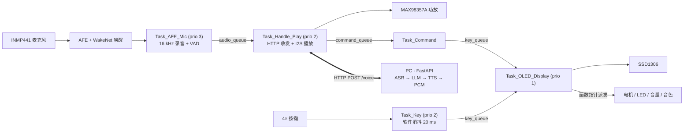
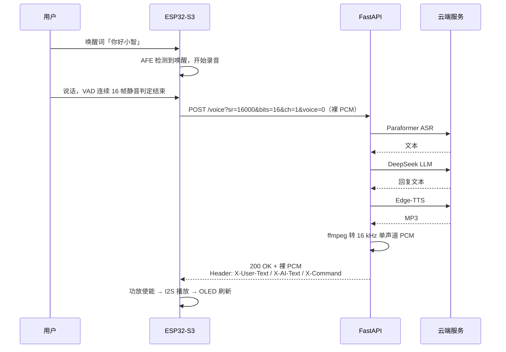

[](https://hub.xerj.org/contributors/3209235361-wq)

# ESP32-S3 AI 语音助手

**说一句话，本地说出回复。** 唤醒词在设备端识别，ASR / LLM / TTS 在 PC 端完成，合成的语音以 PCM 回传、经 I2S 功放播放；本地 OLED 菜单在断网时依然可用，可独立调节电机、LED、音量与音色。

[](LICENSE)


`C` · `ESP-IDF v5.4` · `FreeRTOS` · `esp-sr (AFE + WakeNet)` · `I2S / I2C / LEDC` · `HTTP` · `FastAPI + Python` · `DashScope ASR` · `DeepSeek LLM` · `Edge-TTS`

> **English**: An ESP32-S3 voice assistant — on-device WakeNet wake word, cloud ASR → LLM → TTS over HTTP, PCM playback through a MAX98357A, plus a local OLED menu (intrusive doubly-linked list + `container_of` dispatch) that keeps working when Wi-Fi is down.

---

## 实物图


ESP32-S3 主控 · INMP441 麦克风 · MAX98357A 功放 · SSD1306 OLED · 电机 · LED

## 功能

- **语音对话**：本地唤醒词（WakeNet）→ 录音（VAD 自动断句）→ 上传 → ASR → LLM → TTS → 播放
- **语音控制设备**：说「开灯」「电机高档」等指令，服务端解析后通过 HTTP 响应头 `X-Command` 回传，设备直接执行
- **本地 OLED 菜单**：电机转速 / LED 亮度 / 音量 / 音色 四项，按键导航，**断网可用**
- **音色切换**：4 种 TTS 音色（普通话女声 / 男声 / 粤语 / 英文），可语音或按键切换
- **统一错误处理**：每个初始化动作带错误计数，失败即停并打印，不带病运行

## 硬件

| 器件 | 型号 | 用途 | 引脚 |
|---|---|---|---|
| 主控 | ESP32-S3-N16R8（16 MB Flash / 8 MB PSRAM） | 主控 | — |
| 麦克风 | INMP441（I2S 数字麦） | 录音 | SD → GPIO2 |
| 功放 | MAX98357A（I2S 功放） | 播放 | DIN → GPIO5，SD（使能）→ GPIO4 |
| 显示屏 | SSD1306 0.96"（I2C） | 本地 UI | 见 `components/SSD1306/ssd1306.h` |
| 按键 | 4× 独立按键 | 菜单导航 | UP 14 / DOWN 13 / OK 12 / EXIT 11 |
| LED | 单色 LED（PWM 调光） | 4 档亮度 | GPIO7（LEDC 通道 1，1 kHz） |
| 电机 | 直流电机 + 驱动板 | 4 档转速 | AIN1 8 / AIN2 9 / PWMA 10（10 kHz） |

> 麦克风与功放**共用同一路 I2S 总线**（BCLK 41 / LRCK 42），ESP32 为主模式，16 kHz / 16 bit / 单声道。

## 系统架构



**语音数据流**



**设备侧接口**

```c
bool voice_send_receive(const int16_t *pcm_in, size_t len_in,
                        int16_t *pcm_out, size_t *len_out);
```

输入 / 输出均为 16 kHz、16 bit、单声道裸 PCM；响应头携带识别文本、回复文本与语音指令（URL 编码）。

**分区表**：`nvs` 24 KB · `phy_init` 4 KB · `factory` 6 MB · `model` 2 MB（唤醒词模型独立分区）

## 目录结构

```
components/
  Audio/          I2S 麦克风 + 功放（共用总线）
  Voice_Wakeup/   esp-sr AFE + WakeNet 唤醒引擎
  Wi-Fi/          STA 连接 + 状态回调
  http_client/    /voice 接口客户端、响应头解析、溢出保护
  UI_manager/     侵入式双向循环链表 + container_of + 函数指针派发
  SSD1306/        OLED 驱动与字库
  LED_and_KEY/    按键消抖 + LED PWM 调光
  Monitor/        电机 PWM 调速
  Command_Handle/ 语音指令表（Cmd_t）+ 统一派发
  check_err/      初始化错误检查宏（CHECK_ERR / CHECK_POINTER / INIT_CHECK_ERR）
main/
  main.c            任务创建、队列与信号量、初始化流程
  Kconfig.projbuild WiFi 与后端地址配置（走 menuconfig）
python_server/
  server.py         FastAPI：POST /voice（HTTP）+ WS /chat
  pipeline.py       ASR → LLM → TTS → PCM 全链路
docs/              调试记录与测试报告：I2S 音量振幅分析、双缓冲设计、9 小时稳定性测试（含原始日志）
partitions.csv      分区表
```

## 关键设计（为什么这么做）

**1. 双缓冲 + 双二值信号量，替换原来的互斥锁**

最初 Mic 与 Play 共用一把 mutex，Play 持锁最长达 30 秒（等网络 + 播放），期间 Mic 任务被阻塞，无法接收下一次录音。改造后：两块录音缓冲 + 两个二值信号量，缓冲区的**所有权在任务间转移**——Mic 拿到空闲块才写，Play 用完立刻归还。效果是 Mic 任务**永远不会等 Play**，连续多轮对话不会覆盖上一轮数据。

**2. 侵入式双向循环链表管理 UI**

`Node_t` 内嵌 `mList_t` 节点，用 `container_of` 从链表节点反推出对象地址，每个节点带自己的 `func` 回调，按键导航只操作链表，**不关心具体是哪个设备**。新增一个可调设备 = 加一个 `Node_t` + 写一个 `xxx_adjust()`，导航与显示代码零改动。

**3. 语音指令用表驱动派发**

`Cmd_t cmd_gear[8]` 把「指令字符串 → 处理函数」做成一张表，`handle_cmd()` 线性查表执行。新增档位只需往表里加一行，`Task_Command` 不用改。

**4. 事件驱动刷新，没有轮询任务**

Wi-Fi 状态变化通过回调 `WiFi_SetStateCallBack()` 注册，收到事件后往 `key_queue` 投一条刷新消息，UI 任务醒来重绘，省掉一个定时轮询任务。

**5. 配置不进代码仓库**

Wi-Fi SSID / 密码、后端 IP / 端口全部走 `idf.py menuconfig`（`main/Kconfig.projbuild`），生成到 `sdkconfig`，而 `sdkconfig` 已被 `.gitignore` 排除。**仓库里不出现任何真实密码。**

**6. 初始化失败就停下来**

`CHECK_ERR` / `CHECK_POINTER` 在每步初始化上累加错误计数，`app_main` 末尾用 `INIT_CHECK_ERR` 统一断言。失败时打印错误数并停住，而不是带着半初始化状态继续跑（`Task_AFE_Mic` 里 malloc 失败同样会停住，避免空指针）。

## 量化指标

> 测量方式：`esp_timer_get_time()` 微秒级打点（唤醒 / 录音结束 / 收到响应 / 功放使能），主循环每 10 分钟采样一次内部堆、PSRAM 与片内温度。

**对话延迟（同一固件，两种网络时段各测一轮）**

| 指标 | 白天（11:00，14 轮） | 夜间（01:00，12 轮） |
|---|---|---|
| 录音 `rec` | 1.6 – 5.0 s | 1.4 – 5.0 s |
| 网络 + 服务端 `net` | **3.9 – 10.3 s**（中位 ≈7.5） | 8.8 – 14.6 s |
| 唤醒 → 收到音频 `total` | 5.5 – 15.3 s | 10.3 – 19.6 s |
| 成功率 | 11/14 | 9/12 |

同样的设备与固件，夜间延迟约为白天的 1.5 倍，说明波动主要来自网络与服务商，而非设备侧。

> `net` 中可能包含等待上一条回复播放完成的时间；`total` 是收到音频的时刻，实际出声还要加功放使能与 I2S 启动（实测 0.2 ms 量级）。

**服务端耗时构成**（多次样本）

| 阶段 | 耗时 |
|---|---|
| ASR | 1.2 – 1.6 s |
| LLM | 2.6 – 5.1 s（波动最大） |
| TTS | 2.5 – 3.2 s |
| MP3 → PCM | ≈ 0.1 s |
| 下载 | 486 KB ≈ 1.5 s（≈ 311 KB/s） |

TTS 耗时几乎不随文本长度变化 —— 主要开销在 WebSocket 建连，而非合成本身。

**一处交叉校验**：上传 113,708 B ÷ 2 ÷ 16,000 Hz = **3.553 s**，与设备测得的录音时长 3.51 s 吻合——说明两端计时与字节统计一致。

**稳定性（9 小时连续运行 + 14 轮对话）**

| 项目 | 结果 |
|---|---|
| 内部堆 cur | 179,963 B，待机 9 小时波动 ±44 B |
| 内部堆最低水位 | 167,511 B（待机）/ 156,923 B（对话峰值） |
| PSRAM | 5,590,216 B 恒定（音频缓冲全部预分配） |
| 片内温度 | 32.2 – 37.2 °C，无上升趋势 |
| 重启 / 断连 / 看门狗 | 0 |

详见 [`docs/9小时稳定性测试.md`](docs/9小时稳定性测试.md)，原始日志见同目录。

**已知优化方向**（按收益排序）：LLM 流式 + TTS 分句合成 → 下载边收边播 → 上行/下行 ADPCM 压缩 → ASR 流式化。当前全链路串行，是延迟的主要来源。

## 故障档案

**#1 播放任务长时间持锁，录音任务饿死**

- 现象：连续对话时偶尔丢一轮录音，或播放到一半出现旧数据
- 原因：`for_record` mutex 被 Play 任务持有最长 30 s（网络 + 播放期间），Mic 任务取不到锁
- 定位：对比任务运行时间与 mutex 持有区间，确认阻塞点在 Play
- 修复：改为双缓冲 + 双二值信号量，缓冲所有权转移（见「关键设计」第 1 条）
- 回归：连续 3 轮对话不再覆盖数据，Mic 任务阻塞消失

**#2 I2S 收发初始化顺序错误导致声音失真**

- 现象：偶尔上电后声音变调 / 噪声
- 原因：功放通道是时钟主机，若先初始化 RX 再初始化 TX，时钟尚未建立
- 修复：**必须先初始化 TX（提供 BCLK/LRCK），再初始化 RX**
- 回归：拨动音量与播放长音频时波形正常（见 `docs/I2S音量振幅分析.md`）

**#3 响应数据超出接收缓冲时静默截断**

- 现象：长回复播放不完整，且无明显报错
- 原因：`_http_event_handler` 里缓冲区溢出判断缺失，超出部分被静默丢弃
- 修复：增加 `g_recv_overflow` 标志，溢出时记录实际/上限字节数并让本次请求返回失败
- 回归：超长回复会打印告警并走失败分支，不再播放半截音频

## 构建与运行

**设备侧**（ESP-IDF v5.4）

```bash
idf.py set-target esp32s3

# 配置 WiFi 与后端地址（生成 sdkconfig，不进仓库）
idf.py menuconfig
#   Chat Assistant Configuration
#     ├─ WiFi SSID
#     ├─ WiFi password
#     ├─ Backend server IP     (手机热点一般是 172.20.10.x)
#     └─ Backend server port   (默认 8006)

idf.py -p COMx flash monitor
```

**服务端**（PC，需与 ESP32 处于同一网段）

```bash
cd python_server
pip install -r requirements.txt          # 另需 ffmpeg（或 pip install imageio-ffmpeg）

set DASHSCOPE_API_KEY=your_key           # Linux/macOS: export ...
set DEEPSEEK_API_KEY=your_key

python server.py                         # 监听 0.0.0.0:8006
```

启动后终端会打印 `POST http://<ip>:8006/voice` 与 `WS /chat` 两个入口；设备使用前者。

## 已知限制

- **全链路串行**：录音 → 上传 → ASR → LLM → TTS → 下载 → 播放，每段都等前一段彻底结束；实测「唤醒 → 收到音频」5.5 – 15.3 s，其中 LLM 占 2.6 – 5.1 s
- **短语音无反馈**：唤醒后录音不足 1 秒会被服务端以 `400` 拒绝（音频长度校验），设备端只打一条错误日志，用户听不到任何提示
- **音频未压缩**：上行 111 KB / 下行 486 KB，弱网环境下网络占比显著
- **依赖公网 API**：ASR / LLM / TTS 延迟受服务商与网络影响，不可控
- **VAD 尾部固定 16 帧**（约 0.5 s），对环境噪声偏保守
- **唤醒词模型占 2 MB Flash**，固件分区相应压缩到 6 MB
- **未做多轮上下文截断**：`history` 随对话轮数增长，长会话下 LLM 输入会变长

## 致谢

- [esp-sr](https://github.com/espressif/esp-sr)（WakeNet 唤醒词 + AFE 音频前端）
- [ESP-IDF](https://github.com/espressif/esp-idf)
- [Edge-TTS](https://github.com/rany2/edge-tts) · [DashScope](https://dashscope.aliyun.com/) · [DeepSeek](https://www.deepseek.com/)

## License

[MIT](LICENSE) © 2026 Jiang
